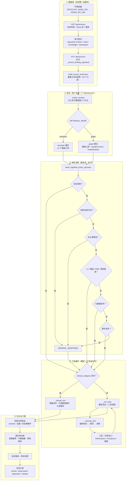

# 图 1 · 端到端总览

> 智能分析 Agent 全链路流程图 · 第 1/9 张 —— 数据源 → 会话 → 单轮策略 → 工具循环 → 交付与门禁的整体拓扑，含不依赖渲染器的 ASCII 兜底图。
> 基线 2026-09-20，仓库工作区当前代码；不含真实凭据、密钥或内部绝对路径。
> 返回 [图目录](README.md) ｜ 节点 → 代码位置见 [README §10](README.md#10-节点--代码位置索引)。

---



### 1.1 无渲染器时的 ASCII 兜底

```text
        ┌────────────────────── ① 数据源（启动期 / 设置页） ──────────────────────┐
        │ 环境变量 → GET /api/sources → 本体库 ⇄ Doris/meta/knowledge/namespace  │
        │            → PUT /api/sources（签名变化才重建）→ build_source_executors │
        └───────────────────────────────────┬─────────────────────────────────────┘
                                            ▼
        ┌────────────────────── ② 会话（每会话一个 WebSession） ───────────────────┐
        │ 上下文头（repository_id / namespace / doris_database）                  │
        │ RETRIEVAL_MODE = semantic（14 工具） ┊ graph（+GraphContext/GraphExpand）│
        └───────────────────────────────────┬─────────────────────────────────────┘
                                            ▼
        ┌──────────── ③ 单轮决策 build_cognitive_policy_decision（无 IO）─────────┐
        │ 0 安全拒绝 → 1 空/泛问 → 1b 无主语预测 → 2 L2/根因/行动/预测推演        │
        │ → 3 元数据本体 → 4 事实查询 → 5 兜底 GENERAL_RESPONSE                   │
        └───────────────────────────────────┬─────────────────────────────────────┘
                                            ▼
        ┌────────────────────── ④ 工具循环（模型 + 工具运行时） ───────────────────┐
        │ refusal_category 非空 → _refusal_turn（不进模型循环 · 工具被封）        │
        │ 否则 _run_loop → _execute_tool（越权校验/限流）→ 工具 → 回灌模型        │
        └───────────────────────────────────┬─────────────────────────────────────┘
                                            ▼
        ┌──────────────────────── ⑤ 交付与门禁 ──────────────────────────────────┐
        │ 回答合同（schema/证据/未支撑数字）→ 真实性（因果/代理/预测假设）        │
        │ → 会话落库与恢复快照 → 评测门禁（smoke/adversarial/regression/release） │
        └────────────────────────────────────────────────────────────────────────┘
```
