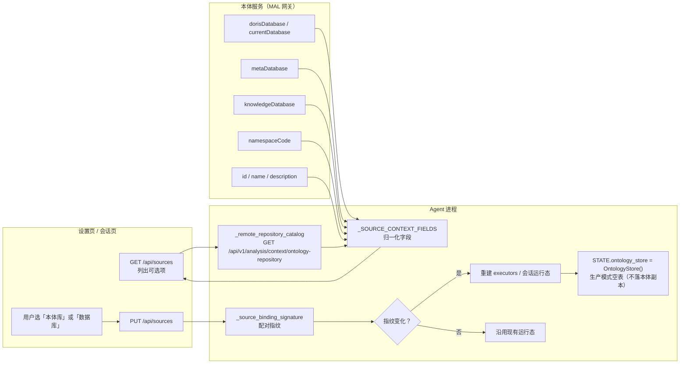

# 图 2 · 数据源原子配对

> 智能分析 Agent 全链路流程图 · 第 2/9 张 —— 设置页 GET/PUT `/api/sources`、目录字段归一化、配对指纹比较与运行态重建。
> 基线 2026-09-20，仓库工作区当前代码；不含真实凭据、密钥或内部绝对路径。
> 返回 [图目录](README.md) ｜ 节点 → 代码位置见 [README §10](README.md#10-节点--代码位置索引)。

---

`bi_agent/web/app.py:1721` `get_sources_endpoint` / `:1869` `put_sources_endpoint`。

关键约束：

- **原子配对**：改"本体库"或"数据库"任意一侧，都会同时改写另一侧；工具只有在下一次重新绑定后才生效。
- **本体内容不落本地**：生产模式 `STATE.ontology_store` 是空表，只用于满足旧接口类型；本体内容 100% 走 HTTP。
- **目录接口失败不阻塞设置页**：有 30s 冷却重试（`app.py:1748` 附近），恢复后无需重启进程。
