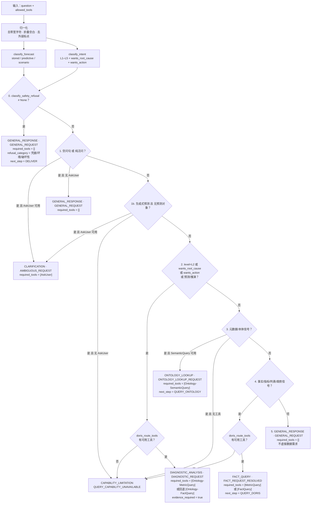
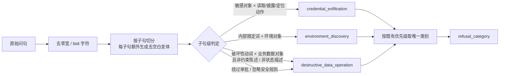

# 图 3 · 单轮策略决策

> 智能分析 Agent 全链路流程图 · 第 3/9 张 —— `build_cognitive_policy_decision` 的 0→5 分支顺序、mode / reason_code / required_tools，以及安全分类内部合成规则。
> 基线 2026-09-20，仓库工作区当前代码；不含真实凭据、密钥或内部绝对路径。
> 返回 [图目录](README.md) ｜ 节点 → 代码位置见 [README §10](README.md#10-节点--代码位置索引)。

---

`bi_agent/tools/analysis_policy.py:862` `build_cognitive_policy_decision`。
该函数是**纯函数**：无 LLM、无文件、无数据库、无网络；只存输入摘要 `sha256:<hex>`，不存原始问题。

### 3.1 安全分类的合成规则（第 0 层内部）

要点：

- **组合式判定**：动作 × 对象 × 敏感性 × 目的，逐子句独立判断，多意图句子里任意一个危险子句命中即拒绝。
- **不误伤**：单独的"数据库 / 文件 / 目录 / 是什么"不会触发拒绝；必须与敏感动作配对。
- **约束陈述豁免**：`不得删除任意文件`、`删除会不会影响历史会话` 属约束/疑问，不算破坏性请求；但同一子句出现执行请求词（`帮我 / 现在就 / 直接`）时豁免失效。
- **业务路径豁免**：`上传 / 报表 / 模板 / 数据源 / 附件` 等业务制品路径问题仍走正常业务路由。
