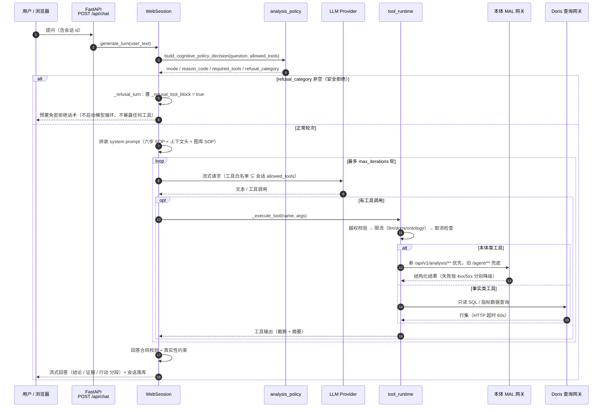

# 图 4 · 单轮时序

> 智能分析 Agent 全链路流程图 · 第 4/9 张 —— 用户 / API / WebSession / analysis_policy / LLM / tool_runtime / 本体 MAL / Doris 的完整交互时序。
> 基线 2026-09-20，仓库工作区当前代码；不含真实凭据、密钥或内部绝对路径。
> 返回 [图目录](README.md) ｜ 节点 → 代码位置见 [README §10](README.md#10-节点--代码位置索引)。

---

