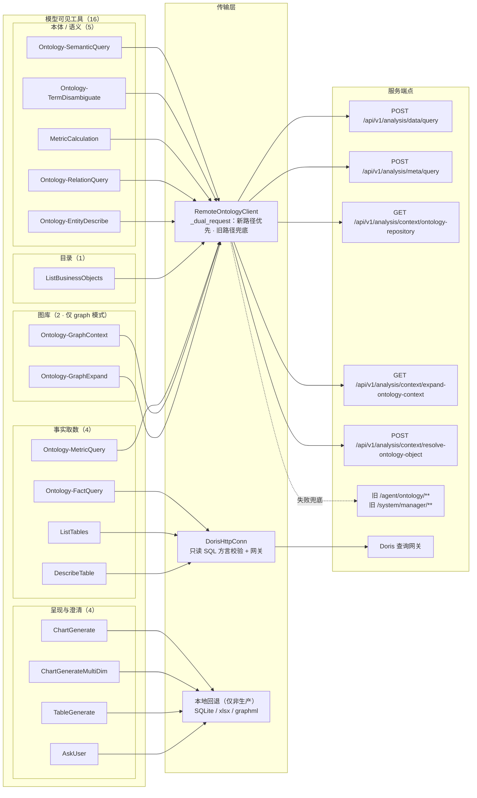
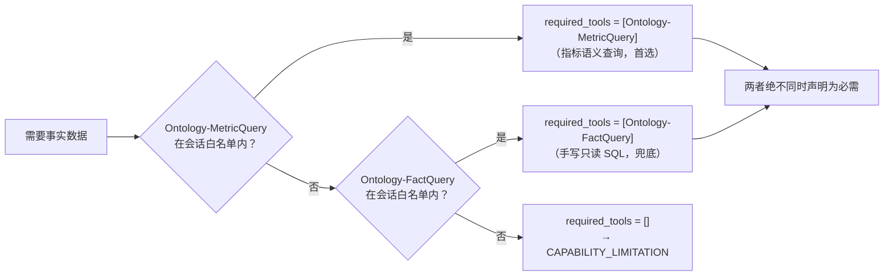

# 图 5 · 工具与端点映射

> 智能分析 Agent 全链路流程图 · 第 5/9 张 —— 16 个模型可见工具、新旧双栈路径、以及 MetricQuery 优先 / FactQuery 兜底的取数规则。
> 基线 2026-09-20，仓库工作区当前代码；不含真实凭据、密钥或内部绝对路径。
> 返回 [图目录](README.md) ｜ 节点 → 代码位置见 [README §10](README.md#10-节点--代码位置索引)。

---

工具注册：`bi_agent/tools/__init__.py:48` `build_source_executors`、`:81` `register_all`；
白名单：`.claude/agents/bi-analyst.md:5`（14 个基础工具）+ 图库模式追加 2 个。

事实取数优先级（`analysis_policy.py:899` `doris_route_tools`）：

