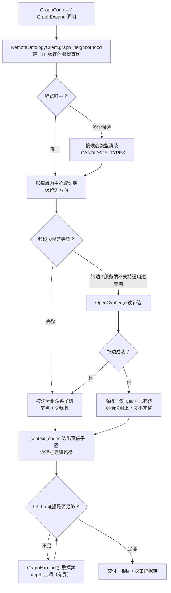

# 图 6 · 图库检索模式

> 智能分析 Agent 全链路流程图 · 第 6/9 张 —— 锚点消歧 → 有界邻域 → OpenCypher 只读补边 → 降级 → GraphExpand 扩散探索。
> 基线 2026-09-20，仓库工作区当前代码；不含真实凭据、密钥或内部绝对路径。
> 返回 [图目录](README.md) ｜ 节点 → 代码位置见 [README §10](README.md#10-节点--代码位置索引)。

---

开启方式：`app.py:3513` 在基础工具后追加 `Ontology-GraphContext` / `Ontology-GraphExpand`，
并注入 `GRAPH_MODE_SOP`（`app.py:862`）；本地图库文件在远程模式下只作为只读兼容提示（`app.py:1737`）。

