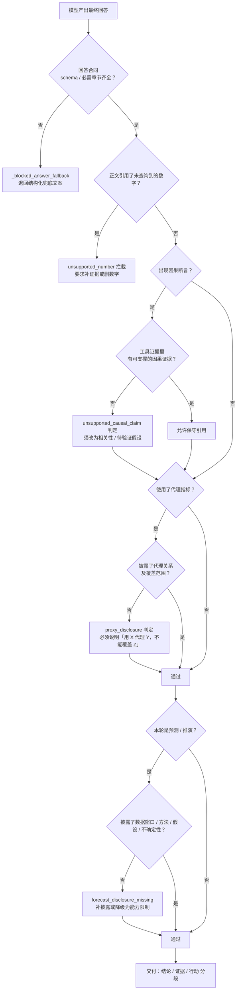

# 图 7 · 回答真实性约束

> 智能分析 Agent 全链路流程图 · 第 7/9 张 —— 回答合同、未支撑数字、因果越界、代理指标披露、预测假设披露的判定顺序。
> 基线 2026-09-20，仓库工作区当前代码；不含真实凭据、密钥或内部绝对路径。
> 返回 [图目录](README.md) ｜ 节点 → 代码位置见 [README §10](README.md#10-节点--代码位置索引)。

---

