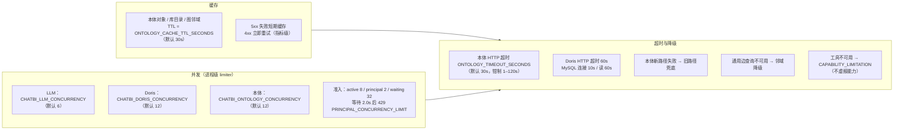

# 图 8 · 缓存并发与降级

> 智能分析 Agent 全链路流程图 · 第 8/9 张 —— 本体缓存 TTL、三个进程级 limiter、准入控制、超时与各类降级路径。
> 基线 2026-09-20，仓库工作区当前代码；不含真实凭据、密钥或内部绝对路径。
> 返回 [图目录](README.md) ｜ 节点 → 代码位置见 [README §10](README.md#10-节点--代码位置索引)。

---

会话资源（`bi_agent/concurrency.py:123`）：空闲 TTL 7200s、内存会话上限 500。
