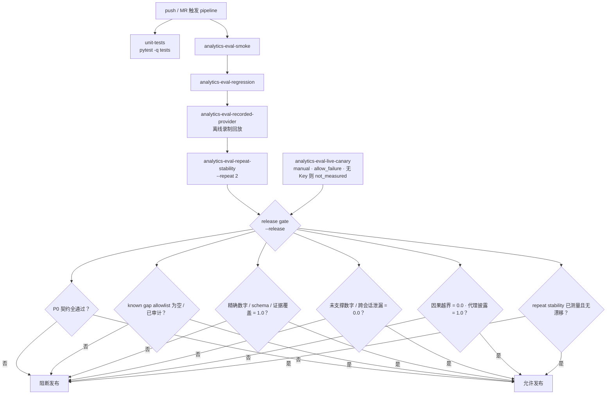

# 图 9 · 评测与发布门禁

> 智能分析 Agent 全链路流程图 · 第 9/9 张 —— CI 作业链、release gate 的六类必过门与被阻断条件、live canary 的边界。
> 基线 2026-09-20，仓库工作区当前代码；不含真实凭据、密钥或内部绝对路径。
> 返回 [图目录](README.md) ｜ 节点 → 代码位置见 [README §10](README.md#10-节点--代码位置索引)。

---

要点：

- **普通开发 pipeline** 快速、确定性、可单次运行；`repeat_stability` 允许显示 `not_measured`。
- **正式 release gate** 必须真实重复运行并比较语义指纹；`not_measured` / 零样本 / 第二次 skip 一律阻断。
- **live canary** 是独立的外部测量层，缺 Provider Key 时为 `not_measured`，**不得**写成 pass，也不得用生产 Key 冒充。
