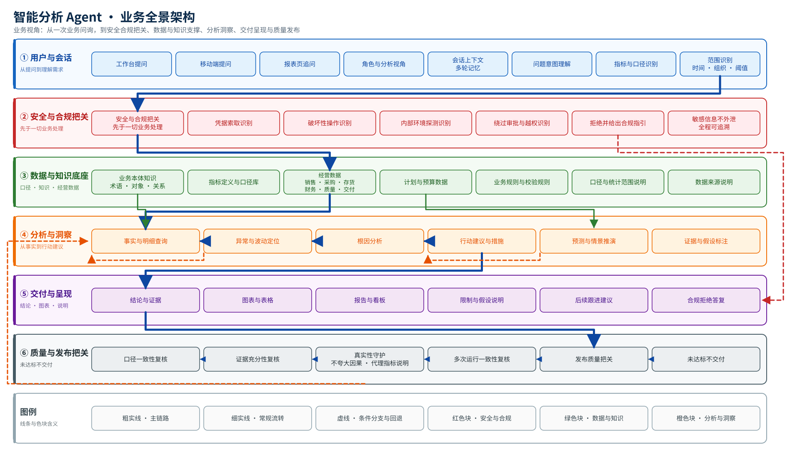

# 智能分析 Agent · 业务全景架构（16:9 横版）

> 业务视角全景图：从一次业务问询，到安全合规把关、数据与知识支撑、分析洞察、
> 交付呈现与质量发布。全文只使用业务角色、业务对象和业务动作的语言，
> 不出现任何技术实现细节。出图比例 16:9（1920 × 1080），铺满整个画框。

## 一图读法：六段业务主线

| 段 | 业务含义 | 关键业务动作 |
|---|---|---|
| ① 用户与会话 | 业务用户从工作台、移动端或报表页提出问题 | 角色与分析视角选择、多轮记忆、问题意图理解、指标与口径识别、时间组织阈值范围识别 |
| ② 安全与合规把关 | 任何业务处理之前先过安全线 | 凭据索取、破坏性操作、内部环境探测、绕过审批与越权四类识别；命中即拒绝并给出合规指引 |
| ③ 数据与知识底座 | 业务问题需要的事实与语义依据 | 业务本体知识、指标定义与口径库、经营数据、计划与预算数据、业务规则与校验规则、口径与来源说明 |
| ④ 分析与洞察 | 从事实一路走到可执行的建议 | 事实与明细查询 → 异常与波动定位 → 根因分析 → 行动建议与措施；另有预测与情景推演、证据与假设标注 |
| ⑤ 交付与呈现 | 把结论交付给业务用户 | 结论与证据、图表与表格、报告与看板、限制与假设说明、后续跟进建议、合规拒绝答复 |
| ⑥ 质量与发布把关 | 交付前的六道复核，未达标不交付 | 口径一致性、证据充分性、真实性守护（不夸大因果、代理指标说明）、多次运行一致性、发布质量把关、未达标不交付 |

## 线条与色块的含义

- 粗实线（深蓝）—— 业务主链路：提问 → 安全把关 → 取数与知识 → 分析洞察 → 交付。
- 细实线（灰色、绿色）—— 常规流转：数据与知识供给分析，以及质量复核之间的先后顺序。
- 虚线（红色）—— 安全与合规分支：识别命中后直接跳转到合规拒绝答复，不再进入任何业务分析。
- 虚线（橙色）—— 条件分支与回退：证据不足时回到补充取数、推演结论进入行动建议、真实性复核发现问题时回到补证。
- 色块按业务域区分：蓝色为用户与会话、红色为安全与合规、绿色为数据与知识、橙色为分析与洞察、紫色为交付与呈现、灰色为质量把关。

## 业务使用说明

- 图只描述业务能力与业务走向，不对应任何界面操作步骤。
- 安全与合规把关在时间上先于其它一切业务处理；即使问题里带有"数据库""是什么""口径""有哪些"这类业务词汇，也不会改变这一优先级。
- 数据与知识底座是"依据层"：所有结论、建议和预测都必须能指回这一层的口径、对象与数据范围。
- 预测与情景推演属于分析与洞察，但推演必须标注假设；已有计划与预算数据属于事实，不是系统现场预测。
- 质量与发布把关是交付前的最后一道业务门；复核未通过时业务用户拿到的是限制说明或合规拒绝答复，而不是未经核实的结论。
