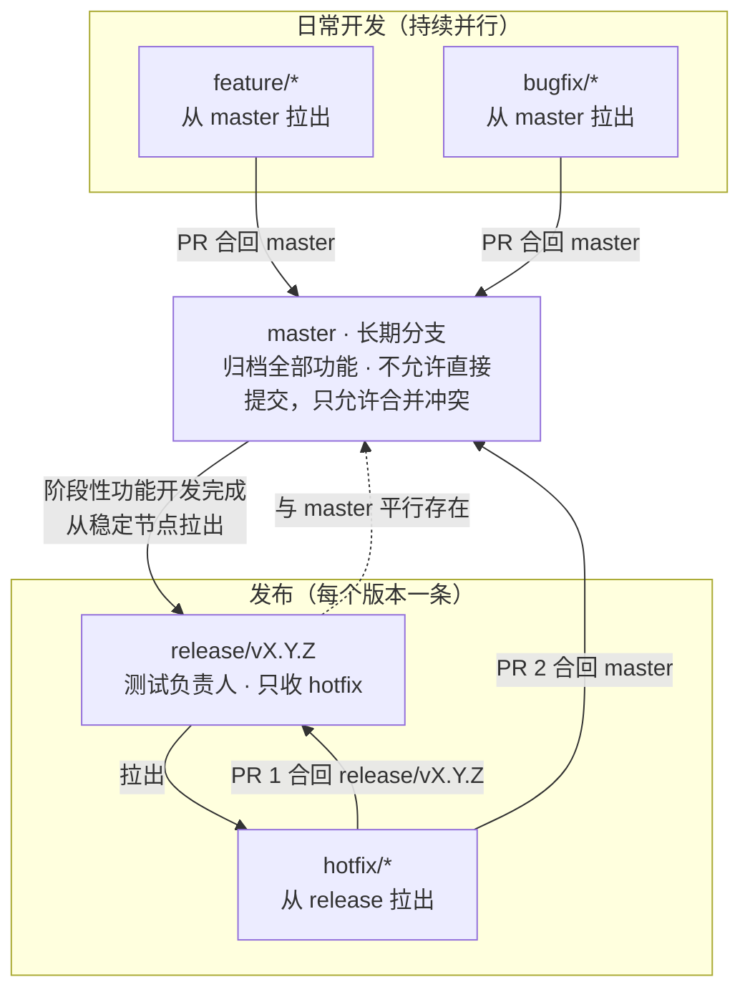

# 图 13 · Git 分支模型

> Git 分支模型、PR 合并与 release / hotfix 机制示意图。
> 规范正文见 [Git 分支与合并工作流规范](../git-branch-workflow.md)；本图是它的图形版，两者应同轮同步。
> 返回 [图目录](README.md)。

---



### 13.1 无渲染器时的 ASCII 兜底

```text
   feature/*  ──PR──┐
                    ├──▶  master · 长期分支 · 归档全部功能 · 不允许直接提交（只允许合并冲突）
   bugfix/*   ──PR──┘                    │
                                         │ 阶段性功能开发完成 → 从稳定节点拉出
                                         ▼
                        release/vX.Y.Z · 测试负责人 · 只收 hotfix   ◀──┐
                                         │ 拉出                       │
                                         ▼                            │
                                     hotfix/*  ──PR 1──────────────────┘
                                         │
                                         └──PR 2──▶  master（保证修复进入归档主干）
```

### 13.2 读图要点

| 要点 | 图中表达 |
| --- | --- |
| 合并显性化 | 所有回流长期分支的箭头都标注 PR，没有直推；`feature/*`、`bugfix/*` 走 PR 回 `master` |
| release 拉出时机 | `master` 在阶段性功能开发完成后，从其**稳定节点**拉出 `release/vX.Y.Z`，不跟随每一次提交 |
| hotfix 双 PR | `hotfix/*` 从 `release/*` 拉出，修复后 **PR 1** 回 `release/*`、**PR 2** 回 `master`，两次都不能少 |
| 并行与归档 | `feature/*` 与 `bugfix/*` 交替持续并入 `master`（归档）；`release/*` 与 `master` 平行存在，只收 `hotfix/*` |
| 命名约定 | 图用 `feature-1`、`bugfix-1`、`hotfix-1` 简化示意；规范以 `feature/`、`bugfix/`、`hotfix/`、`release/` 前缀为准 |
